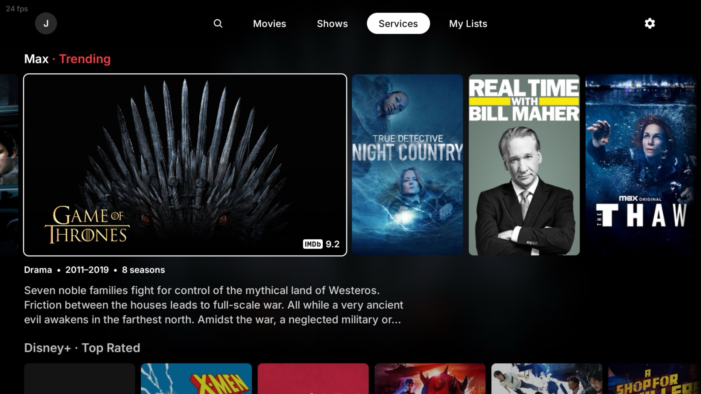
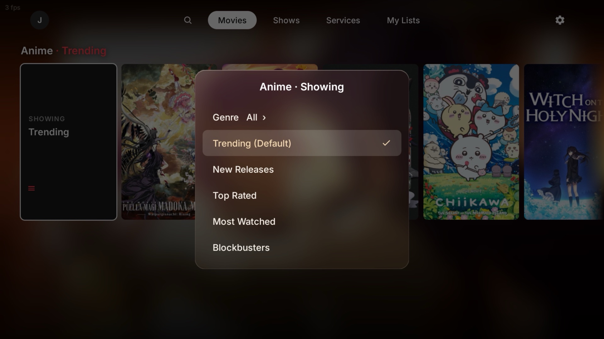
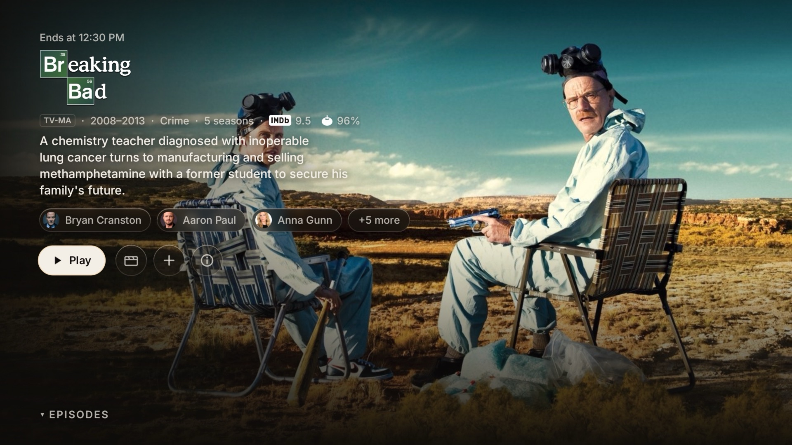

<div align="center">
  

  

  <h1>ChadFlix for Android TV</h1>

  <p>The ChadFlix look and home page on <a href="https://github.com/aradhyas8/Alder">Alder</a>, a Stremio app for Android TV. Built for and tested on the Nvidia Shield TV Pro.</p>

  <p>
    <a href="#features"><b>Features</b></a> ·
    <a href="#install"><b>Install</b></a> ·
    <a href="#ratings">Ratings</a>
  </p>
</div>

An unofficial fork of Alder. This page lists only what ChadFlix changes. Playback, source picking and Stremio sync
are Alder's own: see [Alder](https://github.com/aradhyas8/Alder).

## Features

### Streaming Exclusives

A **Services** tab with a row each for Netflix, Apple TV+, Disney+, Prime Video, Max, Hulu, Paramount+ and Peacock.
**Exclusives Only** (on by default) keeps shows that stream on that service alone. Each row can pick a genre and
Trending, New Series or Top Rated.

<p> </p>

### Showing Tile

The first card of each genre row picks its list:

- **Movies**: Trending (Default), New Releases, Blockbusters, Most Watched, Top Rated.
- **Shows**: Trending (Default), New Series, Most Watched, Top Rated, Complete Series.

Each row keeps its choice.

<p align="center"></p>

### Customizable Home Page

Turn rows on or off and reorder them, separately for Movies, Shows and Services. Hold OK to rearrange. Rows that are
off don't load.

<p align="center"></p>

### Anime Row

An optional row on Movies and Shows. Pick a genre, then a list.

<p align="center"></p>

### Continue Watching

A progress bar on each card and the time left under the row.


### Title Page

IMDb, Rotten Tomatoes and Letterboxd ratings, and when the title ends if you start it now.

<p align="center"></p>

## Install

Build it yourself (JDK 21 and the Android SDK):

```
./gradlew assembleRelease
adb install -r app/build/outputs/apk/release/app-release.apk
```

It installs as **ChadFlix**, next to Alder if you have it. Sign in with your Stremio account.

## Ratings

Rotten Tomatoes and Letterboxd need a free MDBList key: Settings → **MDBList key** (from mdblist.com/preferences).

---

Unofficial; not supported by the authors of Alder. Based on [Alder](https://github.com/aradhyas8/Alder) by aradhyas8,
GPL-3.0 ([LICENSE](LICENSE)). This product uses the TMDB API but is not endorsed or certified by TMDB.
