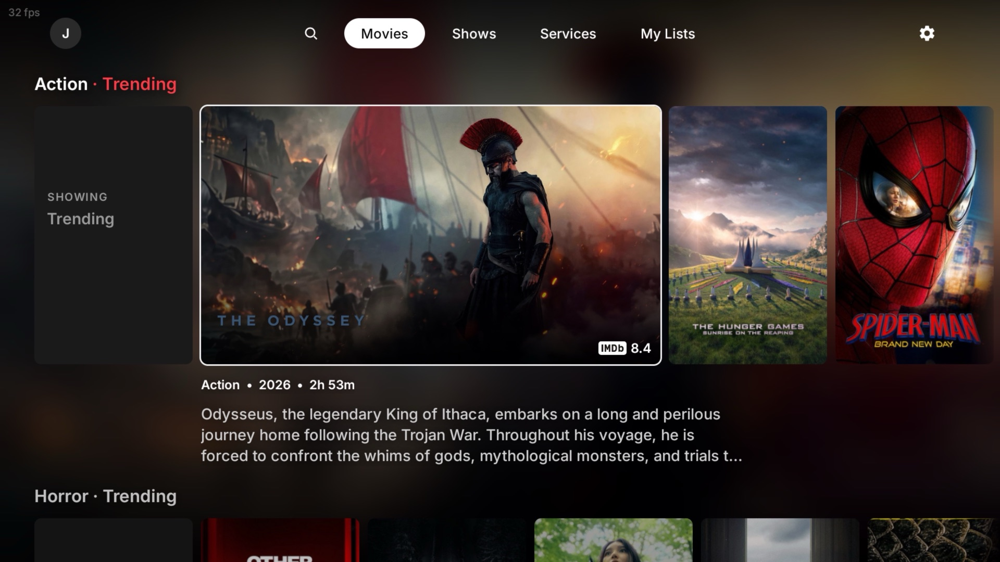
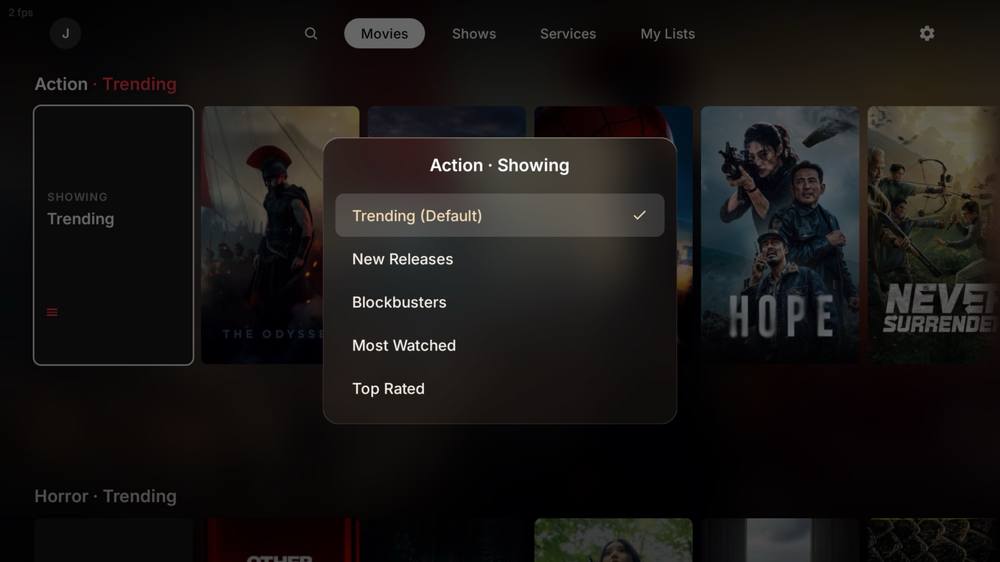
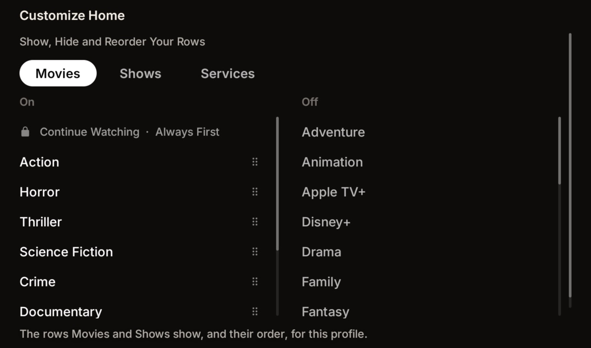

<div align="center">
  

  

  <h1>ChadFlix for Android TV</h1>

  <p>The ChadFlix look and home page on <a href="https://github.com/aradhyas8/Alder">Alder</a>, a Stremio app for Android TV. Built for and tested on the Nvidia Shield TV Pro.</p>

  <p>
    <a href="#features"><b>Features</b></a> ·
    <a href="#install"><b>Install</b></a>
  </p>
</div>

An unofficial fork of Alder. This page lists only what ChadFlix changes. Playback, source picking and Stremio sync
are Alder's own: see [Alder](https://github.com/aradhyas8/Alder).

## Features

### Streaming Exclusives

A **Services** tab with a row each for Netflix, Apple TV+, Disney+, Prime Video, Max, Hulu, Paramount+ and Peacock.
**Exclusives Only** (on by default) keeps shows that stream on that service alone. Each row can pick a genre and
Trending, New Series or Top Rated.

<p> </p>

### Showing Tile

The first card of each genre row picks its list:

- **Movies**: Trending (Default), New Releases, Blockbusters, Most Watched, Top Rated.
- **Shows**: Trending (Default), New Series, Most Watched, Top Rated, Complete Series.

Each row keeps its choice.

<p align="center"></p>

### Customizable Home Page

Turn rows on or off and reorder them, separately for Movies, Shows and Services. Hold OK to rearrange. Rows that are
off don't load.

<p align="center"></p>

### Continue Watching

A progress bar on each card and the time left under the row.


## Install

Claude installs ChadFlix on your TV over your home network. After that, ChadFlix updates itself.

You need a Mac, Windows or Linux (Ubuntu 22.04+ or Debian 12+) computer on the same network as the TV, and the
[Claude desktop app](https://code.claude.com/docs/en/desktop-quickstart) with a paid plan, which the Code tab needs.

### 1. Turn On Network Debugging

On an Nvidia Shield (Android 11):

1. Go to **Settings › Device Preferences › About** and press **Build** seven times.
2. Go to **Settings › Device Preferences › Developer options** and turn on **Network debugging**.
3. Note the address it shows, like `192.168.1.50:5555`.

On other TVs with Android 13 or newer (untested, menu names vary):

1. Go to **Settings › System › About** and press **Android TV OS build** seven times.
2. Go to **Settings › System › Developer options › Wireless debugging**, turn it on and allow it on this network.
3. Note the address it shows. When Claude asks for a pairing code, choose **Pair device with pairing code**: that
   screen has its own port and a code.

### 2. Ask Claude

In the Claude desktop app, open **Code**, choose **Local** and an empty folder, then paste this with your TV's address
in the first line:

```text
My TV's network debugging address is: <IP:PORT>

Install ChadFlix on that TV.

1. Find adb on this computer. If it's missing or has no pair command, show me Google's license
   and ask me before downloading Android SDK Platform-Tools from
   https://developer.android.com/tools/releases/platform-tools
2. Download ChadFlix.apk into this folder, from this address only:
   https://github.com/PaulGitHitGub/ChadFlix-Alder/releases/latest/download/ChadFlix.apk
   Check its SHA-256 against the asset's "digest" in:
   https://api.github.com/repos/PaulGitHitGub/ChadFlix-Alder/releases/latest
   Stop if they differ or you can't read the digest.
3. Ask me whether the TV says "Network debugging" (like an Nvidia Shield) or "Wireless debugging".
   Only for Wireless debugging, ask me for the pairing address and code, then run:
   adb pair <PAIRING IP:PORT> <CODE>
4. Run: adb connect <IP:PORT>
   Then check with: adb devices
   If it says unauthorized, wait for me to allow this computer on the TV.
5. Ask me to confirm nothing is playing on the TV, then run:
   adb -s <IP:PORT> install -r ChadFlix.apk
   If that fails, tell me why. Don't uninstall anything or change TV settings without asking.
6. Check it with: adb -s <IP:PORT> shell pm path team.cyborgs.chadflix
   Then run adb disconnect <IP:PORT> and remind me to turn network debugging off.
```

### 3. Allow the Computer

When the TV asks to allow debugging, choose **Allow**. On a Mac, also allow local network access if macOS asks.

### 4. Finish on the TV

1. Open **ChadFlix** and sign in to Stremio with the code on screen. It installs next to Alder if you have it.
2. Turn network debugging off again. While it's on, never forward its port on your router.

## Updates

ChadFlix offers new versions itself: choose **Install** when it asks, then again when Android asks. The first time,
allow ChadFlix to install apps. Android 11 closes ChadFlix when you do: open it again and choose
**Settings › About › Updates** to finish. Your profiles and settings stay.

---

Unofficial; not supported by the authors of Alder. Based on [Alder](https://github.com/aradhyas8/Alder) by aradhyas8,
GPL-3.0 ([LICENSE](LICENSE)). This product uses the TMDB API but is not endorsed or certified by TMDB.
