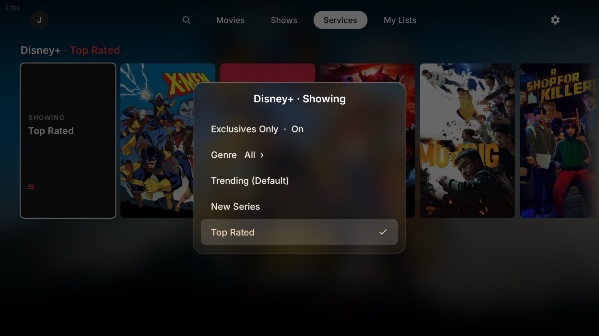
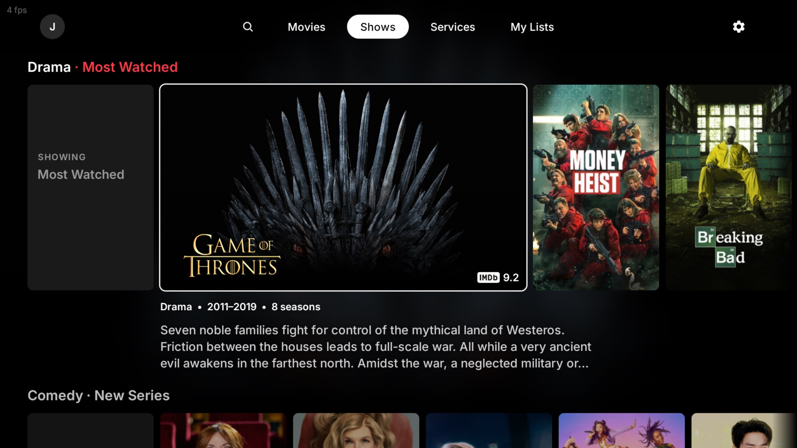
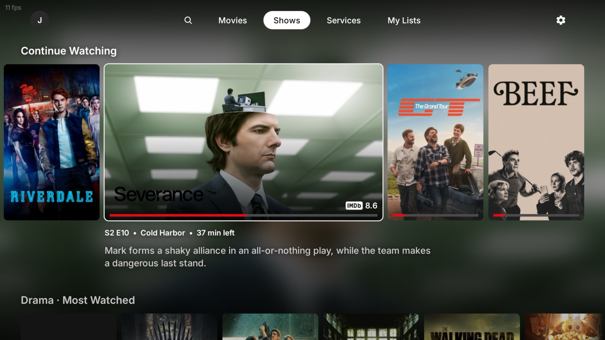

<div align="center">
  

  

  <h1>ChadFlix for Android TV</h1>

  <p>The ChadFlix look and home page on <a href="https://github.com/aradhyas8/Alder">Alder</a>, a Stremio app for Android TV. Built for and tested on the Nvidia Shield TV Pro.</p>

  <p>
    <a href="#features"><b>Features</b></a> ·
    <a href="#install"><b>Install</b></a>
  </p>
</div>

An unofficial fork of Alder. This page lists only what ChadFlix changes. Playback, source picking and Stremio sync
are Alder's own: see [Alder](https://github.com/aradhyas8/Alder).

## Features

<table>
  <tr>
    <td width="50%" valign="top"><br><b>Streaming Exclusives.</b> A Services tab with a row each for Netflix, Apple TV+, Disney+, Prime Video, Max, Hulu, Paramount+ and Peacock.</td>
    <td width="50%" valign="top"><br><b>Exclusives Only.</b> On by default: keeps shows that stream on that service alone. Each row can also pick a genre and Trending, New Series or Top Rated.</td>
  </tr>
  <tr>
    <td valign="top"><br><b>Showing Tile.</b> The first card of each genre row picks its list, like Trending, New Releases, Most Watched or Top Rated.</td>
    <td valign="top"><br><b>Genre Rows.</b> Rows by genre on Movies and Shows. Each one keeps the list you chose.</td>
  </tr>
  <tr>
    <td valign="top"><br><b>Customizable Home Page.</b> Turn rows on or off and reorder them, separately for Movies, Shows and Services. Hold OK to rearrange.</td>
    <td valign="top"><br><b>Continue Watching.</b> A progress bar on each card and the time left under the row.</td>
  </tr>
</table>

## Install

Build it yourself (JDK 21 and the Android SDK):

```
./gradlew assembleRelease
adb install -r app/build/outputs/apk/release/app-release.apk
```

It installs as **ChadFlix**, next to Alder if you have it. Sign in with your Stremio account.

---

Unofficial; not supported by the authors of Alder. Based on [Alder](https://github.com/aradhyas8/Alder) by aradhyas8,
GPL-3.0 ([LICENSE](LICENSE)). This product uses the TMDB API but is not endorsed or certified by TMDB.
